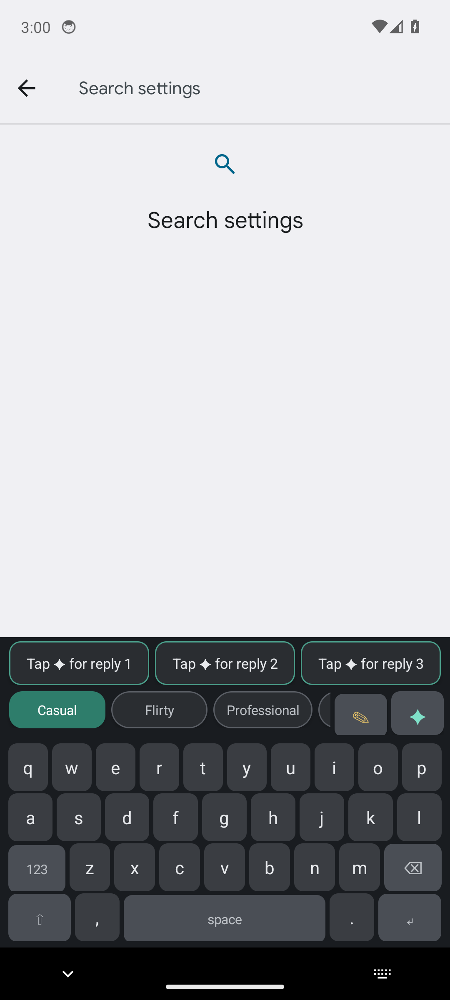
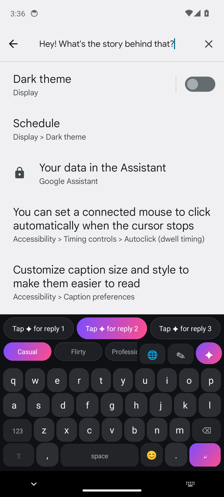
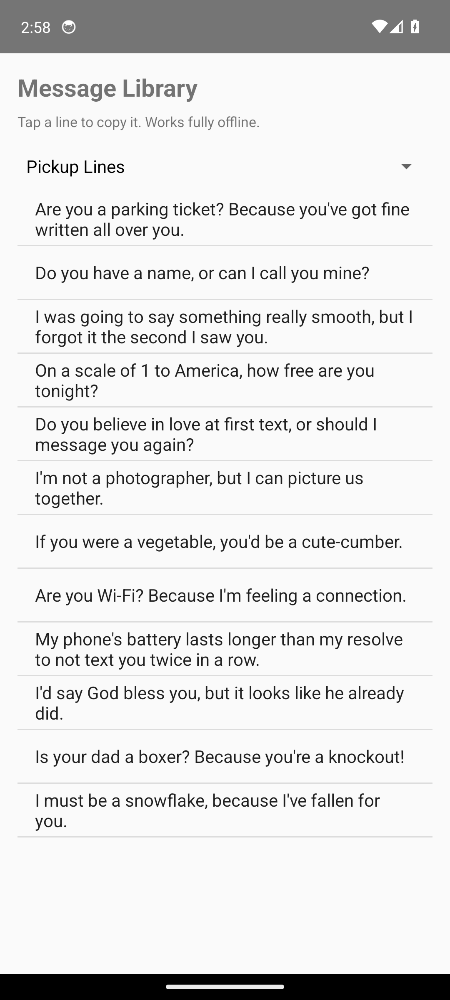

# DMAssistant


**AI dating & DM assistants — a Telegram DM coach and an Android AI keyboard that reads
your chat and writes the replies for you, in 9 selectable tones.**

| | |
|---|---|
| 💬 | Reads the visible chat via Accessibility and suggests 3 replies per tap |
| 🎭 | 9 tones: Casual · Flirty · Professional · Funny · Direct · Spicy · Confident · Savage · Smooth |
| 🧠 | Mood & trap detection (dry texters, love-bombing, money talk) baked into every reply |
| 📸 | Screenshot analyzer: auto-detects profile / chat / reel / feed, generates openers + red/green flag audits |
| 🇮🇳 | Delhi Gen-Z Hinglish persona preset, emoji panel, offline pickup-line library |
| 🔒 | No backend, no analytics, no accounts — text only goes to the AI provider *you* configure |

Two projects live in this repo:


## Screenshots

| Keyboard with tone chips & AI suggestions | Screenshot analyzer | Offline message library |
|---|---|---|
|  |  |  |

## 1. Telegram DM coach (`main.py`)

A Telegram bot that turns chat/bio screenshots into Delhi Gen-Z style openers and
replies (Gemini + LangChain, deployed on Fly.io). See `main.py` and `fly.toml`.

```bash
export GEMINI_API_KEY=... TELEGRAM_BOT_TOKEN=...
pip install -r requirements.txt
python main.py
```

## 2. AI Reply — Android AI keyboard (`AIReplyKeyboard/`)

The bot's brain, rebuilt as an on-device Android app:

- **AI keyboard** (InputMethodService) with 9 tone modes (Casual, Flirty, Professional,
  Funny, Direct, Spicy, Confident, Savage, Smooth), emoji panel, long-press accents,
  offline fallback suggestions, and a 🌐 keyboard switcher.
- **Screen reader** (AccessibilityService) captures the visible chat text so the ✦
  button generates context-aware replies; per-app tone memory; excluded-app privacy list.
- **Screenshot analyzer** — auto-detects profile/chat/reel/feed, generates openers and
  replies via a vision model, and runs red/green flag audits.
- **Message library** — offline pickup lines, icebreakers, POV openers, voice-note
  scripts and no-reply nudges.
- Works with any OpenAI-compatible provider, including the free self-hosted
  [gemini-web2api](https://github.com/Sophomoresty/gemini-web2api) (preset included).

**Download the signed APK:** [Releases](../../releases) · See `AIReplyKeyboard/README.md` for build/setup, `PRIVACY_POLICY.md` and
`PLAY_STORE_CHECKLIST.md` for publishing.
